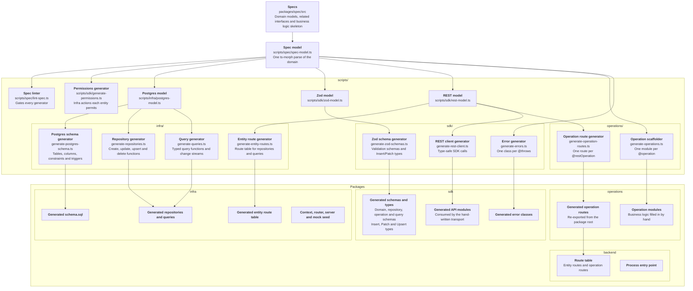
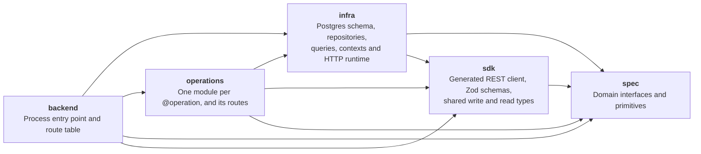

# Spec driven experiment

Humans, this readme is for you.

[`packages/spec/src`](./packages/spec/src/) is mostly a succinct description of what the application is made of. The specification is for demonstrating code generation, this doesn't mean it's an invoicing application, but I use it as an example. Domain models and specified behaviour require understanding the business domain, and Postgres and REST functionality. Everything is defined as TypeScript interfaces, with JSDoc annotations forming a mini-DSL for generating the code.

If you change the TypeScript spec, there are deterministic re-generation scripts that generate:

- Permissions: the infra actions each entity permits, as one const in `packages/sdk`
- Repository functions: create, update, upsert and delete functions
- Operation function stubs, these should contain the business logic
- Query function with granular control of which fields are filterable, orderable and so on
- Change streams backed by Postgres `LISTEN`/`NOTIFY`, whole-table or row-scoped, over REST through server-sent events
- REST endpoints, generated from exposed repository functions and operations

TODO: More specifics goes here.

## Architecture

### Code generation

### Packages

- `infra` - Postgres schema, generated repositories, queries and entity routes,
  plus the request contexts and HTTP runtime.
- `operations` - The operation implementations, one module per `@operation`,
  plus their generated routes, written over `infra`.
- `backend` - The process entry point and the route table, joining infra's
  entity routes with the operation routes.
- `sdk` - Type-safe REST API SDK, shared validation schemas, and shared types
- `spec` - Domain models

### Request data flow

Data for the requests flows through two contexts:

1. `AppContext` is application specific context, created once on startup.
2. `RequestContext` is request specific context, created from `AppContext` for each request.
3. REST endpoint functionality then use parts from the `RequestContext` such as `db: SqlExecutor` or request details like headers.
